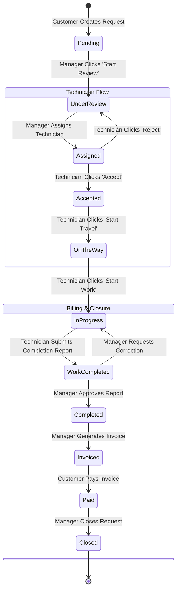

# Field Service Management System: Developer Guide & Reference Manual

Welcome to the complete developer documentation for the **Field Service Management System**. This guide provides an in-depth understanding of the system's architecture, frontend file layout, business workflow state machine, UI tracing paths, and a blueprint for building the future ASP.NET Core Web API and PostgreSQL backend.

---

## 📂 1. Directory Structure & File Map

The frontend is built on **React** with a clean, role-oriented structure. Below is the file map of the `src/` directory:

```text
src/
├── assets/                    # Static graphics and logo SVG assets
├── components/                # Reusable UI widgets and layout modules
│   ├── common/                # Shared layout headers, footers, and sidebars
│   │   ├── AppHeader.jsx      # Top toolbar with user profile and notifications
│   │   ├── AppSidebar.jsx     # Desktop sidebar navigation links
│   │   ├── MobileSidebar.jsx  # Slide-out sidebar for mobile viewports
│   │   └── NotificationButton.jsx # Notification dropdown box
│   ├── layout/                # Generic wrapper components
│   │   └── PageContainer.jsx  # Standard grid width wrapper for consistent layout margins
│   ├── technicians/           # Technician form and detail layout helpers
│   │   └── TechnicianForm.jsx # Add & Edit technician modal profile fields
│   └── ui/                    # Base visual components
│       ├── PageStates.jsx     # Loading spinners and empty state alerts
│       ├── StatusBadge.jsx    # Status-colored labels (e.g. Paid, InProgress)
│       └── Modal.jsx          # Styled modal overlay layout container
├── constants/                 # Core navigation and lookup values
│   └── navigation.js          # Defines role-specific sidebar navigation items
├── context/                   # Global React State Contexts
│   └── AuthContext.jsx        # Login, logout, session state, and role checks
├── data/                      # In-memory database tables (mock lists)
│   ├── serviceRequestsData.js # Array of service request details (Arjun, etc.)
│   ├── techniciansData.js     # Array of technician details (Ravi, Amit, etc.)
│   ├── invoicesData.js        # Array of billing invoice details
│   ├── workReportData.js      # Array of technician work completion reports
│   └── dashboardData.js       # Configurations for dashboard KPIs and quick actions
├── pages/                     # Page views divided by roles
│   ├── customer/              # Customer-specific dashboards and invoices
│   │   ├── CustomerDashboard.jsx # Quick stats, billing widget, active jobs
│   │   └── InvoicesPage.jsx   # List of invoices issued to customer
│   ├── management/            # Manager and Owner operations
│   │   ├── CompletedWorkPage.jsx # Completed job queue awaiting manager review
│   │   ├── DashboardPage.jsx  # Main dispatch dashboard layout
│   │   ├── GenerateInvoicePage.jsx # Invoicing creator form
│   │   ├── ManagementRequestDetailsPage.jsx # Details panel for assigning or closing requests
│   │   ├── ManagementRequestsPage.jsx # All service requests grid
│   │   ├── ManagementTechniciansPage.jsx # Technician directory
│   │   ├── ReviewWorkReportPage.jsx # Technician completion report review page
│   │   └── TechnicianDetailsPage.jsx # Individual technician profile and history
│   ├── shared/                # Layouts accessed by multiple roles
│   │   ├── InvoiceDetailsPage.jsx # Standard printable receipt/invoice layout
│   │   └── SettingsPage.jsx   # Profile config, dark/light theme switch
│   └── technician/            # Technician field operations
│       ├── AssignedJobsPage.jsx # List of assigned works
│       ├── JobDetailsPage.jsx # Detailed job instructions and completion report form
│       └── TechnicianDashboard.jsx # Quick stats and today's timeline
├── routes/                    # Navigation routing system
│   ├── AppRoutes.jsx          # Map url paths to pages
│   └── ProtectedRoute.jsx     # Restricts access by user roles
├── services/                  # Business logic services (API mock files)
│   ├── dashboardService.js    # Prepares KPI counts for role dashboards
│   ├── invoiceService.js      # Handles creation, reading, and payment of invoices
│   ├── serviceRequestService.js # Handles assignments, travel states, and closing requests
│   ├── technicianService.js   # Handles technician profile updates and statuses
│   └── workReportService.js   # Handles completion report CRUD operations
└── utils/                     # Formatting tools and status helper functions
    ├── format.js              # Renders dates and Currency (₹) strings
    ├── invoiceCalculations.js # Live calculations helper
    ├── requestStatusRules.js  # Validates request status transitions
    └── technicianHelpers.js   # Maps active jobs and active state to operational statuses
```

---

## 🔄 2. End-to-End Business Workflow (State Machine)

A service request flows through 11 sequential states. The state transitions are governed by [requestStatusRules.js](file:///Users/mr.aniruddh/Desktop/Me/Field%20Service%20Management/Frontend/src/utils/requestStatusRules.js).



### Transition Descriptions
1. **Pending:** Customer submits request. Visible to managers.
2. **UnderReview:** Manager starts review to verify problem details.
3. **Assigned:** Manager assigns a qualified, available technician.
4. **Accepted:** Technician accepts the job assignment.
5. **OnTheWay:** Technician starts travel to customer location.
6. **InProgress:** Technician arrives and begins diagnostics/work.
7. **WorkCompleted:** Technician submits diagnostics report, parts checklist, and labor hours.
8. **Completed:** Manager reviews and approves completion report.
9. **Invoiced:** Manager edits final prices, applies tax/discounts, and sends invoice.
10. **Paid:** Customer simulated credit-card checkout completes successfully.
11. **Closed:** Manager closes and archives request.

---

## 🔍 3. Interactive Click Flow (Tracing Paths)

Below is a detailed trace of what happens under the hood during key user interactions:

### Case A: Technician Submits Completion Report
1. **User Action:** Technician clicks **Complete Work** on [JobDetailsPage.jsx](file:///Users/mr.aniruddh/Desktop/Me/Field%20Service%20Management/Frontend/src/pages/technician/JobDetailsPage.jsx), fills out form (Diagnosis: *"Faulty AC Capacitor"*, Labour: *1.5 hrs / ₹800*, Parts: *AC Capacitor x1*), and clicks **Submit**.
2. **Report Save:** The page invokes `submitWorkReport(requestId, formData, techId, techName)` in [workReportService.js](file:///Users/mr.aniruddh/Desktop/Me/Field%20Service%20Management/Frontend/src/services/workReportService.js). This creates the work report object with `reviewStatus: 'PendingReview'`.
3. **Status Update:** The page invokes `completeJob(requestId, userId, completionData)` in [serviceRequestService.js](file:///Users/mr.aniruddh/Desktop/Me/Field%20Service%20Management/Frontend/src/services/serviceRequestService.js).
   * Request status is updated to `WorkCompleted`.
   * A history log is appended: *"Technician submitted completion report"*.
   * Role-specific notifications are created for Managers and Owners.
4. **View Update:** The UI updates. The technician sees: *"Work Completed — Awaiting manager final review."*

### Case B: Manager Reviews & Approves Completion Report
1. **User Action:** Manager logs in, navigates to `/management/completed-work` ([CompletedWorkPage.jsx](file:///Users/mr.aniruddh/Desktop/Me/Field%20Service%20Management/Frontend/src/pages/management/CompletedWorkPage.jsx)), clicks **Report** on request `SR-1024` ([ReviewWorkReportPage.jsx](file:///Users/mr.aniruddh/Desktop/Me/Field%20Service%20Management/Frontend/src/pages/management/ReviewWorkReportPage.jsx)).
2. **Validation:** Manager verifies diagnosis and parts used.
3. **Approval Trigger:** Manager clicks **Approve Work Report**:
   * Invokes `approveWorkReport(requestId)` in [workReportService.js](file:///Users/mr.aniruddh/Desktop/Me/Field%20Service%20Management/Frontend/src/services/workReportService.js), updating report status to `Approved`.
   * Invokes `approveWork(requestId, userId)` in [serviceRequestService.js](file:///Users/mr.aniruddh/Desktop/Me/Field%20Service%20Management/Frontend/src/services/serviceRequestService.js). Request status becomes `Completed`.
   * Generates notification for the technician: *"Your completion report for SR-1024 has been approved."*
4. **View Update:** The *Generate Invoice* action button is unlocked on the request page.

### Case C: Manager Generates & Sends Invoice
1. **User Action:** Manager clicks **Generate Invoice**:
   * Routes to `/management/invoices/create?requestId=1024` ([GenerateInvoicePage.jsx](file:///Users/mr.aniruddh/Desktop/Me/Field%20Service%20Management/Frontend/src/pages/management/GenerateInvoicePage.jsx)).
2. **Form Pre-fill:** The page auto-loads customer details, technician's labor hours, and parts list.
3. **Price Finalization:** Manager finalizes service charge (e.g. ₹500), sets final labor charge (e.g. ₹800), edits part rates, applies a discount (e.g. ₹100), and Default 18% GST is calculated.
4. **Calculations Hook:** The page calls `calculateInvoiceBreakdown(...)` in [invoiceCalculations.js](file:///Users/mr.aniruddh/Desktop/Me/Field%20Service%20Management/Frontend/src/utils/invoiceCalculations.js). The sidebar updates dynamically.
5. **Generation Trigger:** Manager clicks **Generate & Send**:
   * Invokes `createInvoice(payload)` in [invoiceService.js](file:///Users/mr.aniruddh/Desktop/Me/Field%20Service%20Management/Frontend/src/services/invoiceService.js), creating `INV-2026-105` in the database with status `Pending`.
   * Invokes `markAsInvoiced(requestId, invoiceNumber, userId)` in [serviceRequestService.js](file:///Users/mr.aniruddh/Desktop/Me/Field%20Service%20Management/Frontend/src/services/serviceRequestService.js). Request status becomes `Invoiced`.
   * Triggers customer notification: *"Invoice INV-2026-105 for AC Repair is ready."*
6. **Redirect:** Manager is redirected to `/management/invoices` with a success toast.

---

## ☁️ 5. ASP.NET Core Web API & PostgreSQL Database Implementation Guide

When transitioning from frontend mock services to a production backend, implement the following database schema and API controllers:

### A. Database Entity Schema (PostgreSQL DDL)

Define the database structure using standard SQL migrations or Entity Framework Core classes:

```sql
-- 1. Users Table (Handles JWT Session logins & Roles)
CREATE TABLE "Users" (
    "Id" SERIAL PRIMARY KEY,
    "Email" VARCHAR(150) UNIQUE NOT NULL,
    "PasswordHash" VARCHAR(255) NOT NULL,
    "FirstName" VARCHAR(100) NOT NULL,
    "LastName" VARCHAR(100) NOT NULL,
    "Role" VARCHAR(50) NOT NULL, -- 'Customer', 'Technician', 'Manager', 'Owner'
    "Phone" VARCHAR(20) NOT NULL,
    "CreatedAt" TIMESTAMP DEFAULT CURRENT_TIMESTAMP
);

-- 2. Technicians Profile Table
CREATE TABLE "Technicians" (
    "Id" SERIAL PRIMARY KEY,
    "UserId" INT UNIQUE NOT NULL REFERENCES "Users"("Id") ON DELETE CASCADE,
    "EmployeeCode" VARCHAR(50) UNIQUE NOT NULL, -- e.g. TECH-001
    "Specialization" VARCHAR(100) NOT NULL,
    "EmploymentStatus" VARCHAR(50) DEFAULT 'Active', -- 'Active', 'On Leave', 'Inactive'
    "IsActive" BOOLEAN DEFAULT TRUE,
    "Rating" NUMERIC(3,2) DEFAULT 5.00
);

-- 3. Service Requests Table
CREATE TABLE "ServiceRequests" (
    "Id" SERIAL PRIMARY KEY,
    "RequestNumber" VARCHAR(50) UNIQUE NOT NULL, -- e.g. SR-1024
    "CustomerId" INT NOT NULL REFERENCES "Users"("Id"),
    "CustomerName" VARCHAR(150) NOT NULL,
    "ServiceName" VARCHAR(100) NOT NULL,
    "PreferredDate" DATE NOT NULL,
    "PreferredTime" VARCHAR(50) NOT NULL,
    "AddressShortText" TEXT NOT NULL,
    "Status" VARCHAR(50) DEFAULT 'Pending', -- 'Pending', 'Assigned', 'InProgress', etc.
    "AssignedTechnicianId" INT REFERENCES "Technicians"("Id"),
    "AssignedTechnicianName" VARCHAR(150),
    "InvoiceId" INT, -- Nullable until invoice is created
    "CreatedAt" TIMESTAMP DEFAULT CURRENT_TIMESTAMP
);

-- 4. Status History Log Table
CREATE TABLE "StatusHistories" (
    "Id" SERIAL PRIMARY KEY,
    "ServiceRequestId" INT NOT NULL REFERENCES "ServiceRequests"("Id") ON DELETE CASCADE,
    "Status" VARCHAR(50) NOT NULL,
    "ChangedByUserId" INT NOT NULL REFERENCES "Users"("Id"),
    "ChangedAt" TIMESTAMP DEFAULT CURRENT_TIMESTAMP,
    "Note" TEXT
);

-- 5. Technician Work Reports Table
CREATE TABLE "WorkReports" (
    "Id" SERIAL PRIMARY KEY,
    "ServiceRequestId" INT UNIQUE NOT NULL REFERENCES "ServiceRequests"("Id") ON DELETE CASCADE,
    "TechnicianId" INT NOT NULL REFERENCES "Technicians"("Id"),
    "Diagnosis" TEXT NOT NULL,
    "WorkPerformed" TEXT NOT NULL,
    "LabourHours" NUMERIC(5,2) NOT NULL,
    "SuggestedLabourCharge" NUMERIC(10,2) NOT NULL,
    "Resolution" TEXT NOT NULL,
    "TechnicianNotes" TEXT,
    "WarrantyRecommended" BOOLEAN DEFAULT TRUE,
    "RecommendedWarrantyDays" INT DEFAULT 30,
    "ReviewStatus" VARCHAR(50) DEFAULT 'PendingReview', -- 'PendingReview', 'Approved', 'CorrectionRequired'
    "CorrectionNotes" TEXT,
    "SubmittedAt" TIMESTAMP DEFAULT CURRENT_TIMESTAMP
);

-- 6. Invoices Table
CREATE TABLE "Invoices" (
    "Id" SERIAL PRIMARY KEY,
    "InvoiceNumber" VARCHAR(50) UNIQUE NOT NULL, -- e.g. INV-2026-105
    "ServiceRequestId" INT UNIQUE NOT NULL REFERENCES "ServiceRequests"("Id"),
    "CustomerId" INT NOT NULL REFERENCES "Users"("Id"),
    "CustomerName" VARCHAR(150) NOT NULL,
    "ServiceName" VARCHAR(100) NOT NULL,
    "ServiceCharge" NUMERIC(10,2) NOT NULL,
    "LabourCharge" NUMERIC(10,2) NOT NULL,
    "PartsAmount" NUMERIC(10,2) NOT NULL,
    "TaxAmount" NUMERIC(10,2) NOT NULL,
    "DiscountAmount" NUMERIC(10,2) DEFAULT 0.00,
    "TotalAmount" NUMERIC(10,2) NOT NULL,
    "Status" VARCHAR(50) DEFAULT 'Draft', -- 'Draft', 'Sent', 'Paid', 'Overdue', 'Cancelled'
    "IssuedAt" TIMESTAMP DEFAULT CURRENT_TIMESTAMP,
    "DueDate" TIMESTAMP NOT NULL,
    "PaidAt" TIMESTAMP,
    "WarrantyDays" INT DEFAULT 0,
    "WarrantyNotes" TEXT,
    "Notes" TEXT
);
```

---

### B. ASP.NET Core API Backend Setup

1. **Authentication:** Use JWT (JSON Web Tokens) with a role claim (`ClaimTypes.Role`).
2. **Authorization:** Secure controller endpoints using the `[Authorize(Roles = "Manager,Owner")]` attribute.

#### Example: InvoicesController.cs

```csharp
using Microsoft.AspNetCore.Authorization;
using Microsoft.AspNetCore.Mvc;
using Microsoft.EntityFrameworkCore;
using System.Security.Claims;

[ApiController]
[Route("api/[controller]")]
[Authorize]
public class InvoicesController : ControllerBase
{
    private readonly AppDbContext _context;

    public InvoicesController(AppDbContext context)
    {
        _context = context;
    }

    // GET: api/invoices
    [HttpGet]
    [Authorize(Roles = "Manager,Owner")]
    public async Task<IActionResult> GetAllInvoices()
    {
        var invoices = await _context.Invoices
            .OrderByDescending(i => i.IssuedAt)
            .ToListAsync();
        return Ok(invoices);
    }

    // POST: api/invoices (Generate Billing receipt)
    [HttpPost]
    [Authorize(Roles = "Manager,Owner")]
    public async Task<IActionResult> CreateInvoice([FromBody] CreateInvoiceDto dto)
    {
        // 1. Verify request is completed and approved
        var request = await _context.ServiceRequests.FindAsync(dto.ServiceRequestId);
        if (request == null || request.Status != "Completed")
            return BadRequest("Service request must be in 'Completed' status.");

        // 2. Prevent duplicate invoice creation
        var exists = await _context.Invoices.AnyAsync(i => i.ServiceRequestId == dto.ServiceRequestId);
        if (exists)
            return BadRequest("An invoice already exists for this service request.");

        // 3. Generate sequential invoice number (e.g., INV-2026-105)
        var nextId = await _context.Invoices.CountAsync() + 1;
        var invoiceNumber = $"INV-{DateTime.UtcNow.Year}-{100 + nextId}";

        var invoice = new Invoice
        {
            InvoiceNumber = invoiceNumber,
            ServiceRequestId = dto.ServiceRequestId,
            CustomerId = dto.CustomerId,
            CustomerName = dto.CustomerName,
            ServiceName = dto.ServiceName,
            ServiceCharge = dto.ServiceCharge,
            LabourCharge = dto.LabourCharge,
            PartsAmount = dto.PartsAmount,
            TaxAmount = dto.TaxAmount,
            DiscountAmount = dto.DiscountAmount,
            TotalAmount = dto.TotalAmount,
            Status = dto.Status, // 'Draft' or 'Sent'
            DueDate = dto.DueDate,
            WarrantyDays = dto.WarrantyDays,
            WarrantyNotes = dto.WarrantyNotes,
            Notes = dto.Notes
        };

        _context.Invoices.Add(invoice);

        // 4. Update request status to 'Invoiced'
        request.Status = "Invoiced";
        request.InvoiceId = invoice.Id;

        // 5. Log history
        var userId = int.Parse(User.FindFirst(ClaimTypes.NameIdentifier)?.Value);
        _context.StatusHistories.Add(new StatusHistory
        {
            ServiceRequestId = request.Id,
            Status = "Invoiced",
            ChangedByUserId = userId,
            Note = $"Invoice {invoiceNumber} generated"
        });

        await _context.SaveChangesAsync();
        return CreatedAtAction(nameof(GetInvoiceById), new { id = invoice.Id }, invoice);
    }

    [HttpGet("{id}")]
    public async Task<IActionResult> GetInvoiceById(int id)
    {
        var invoice = await _context.Invoices.FindAsync(id);
        if (invoice == null) return NotFound();

        // Customer privacy check
        var userRole = User.FindFirst(ClaimTypes.Role)?.Value;
        var userId = int.Parse(User.FindFirst(ClaimTypes.NameIdentifier)?.Value);
        if (userRole == "Customer" && invoice.CustomerId != userId)
            return Forbid();

        return Ok(invoice);
    }

    // POST: api/invoices/{id}/pay
    [HttpPost("{id}/pay")]
    public async Task<IActionResult> PayInvoice(int id)
    {
        var invoice = await _context.Invoices.FindAsync(id);
        if (invoice == null) return NotFound();

        invoice.Status = "Paid";
        invoice.PaidAt = DateTime.UtcNow;

        var request = await _context.ServiceRequests.FindAsync(invoice.ServiceRequestId);
        if (request != null)
        {
            request.Status = "Paid";
            var userId = int.Parse(User.FindFirst(ClaimTypes.NameIdentifier)?.Value);
            _context.StatusHistories.Add(new StatusHistory
            {
                ServiceRequestId = request.Id,
                Status = "Paid",
                ChangedByUserId = userId,
                Note = "Invoice payment received"
            });
        }

        await _context.SaveChangesAsync();
        return Ok(invoice);
    }
}
```

---

### C. Replacing Mock Services with Real API Calls

Update your frontend services (e.g. `invoiceService.js`) to interact with your new backend API using `axios`:

```javascript
// src/services/invoiceService.js
import axios from 'ajax';

const API_URL = 'http://localhost:5000/api/invoices';

// Add JWT Bearer token to request headers
const getAuthHeaders = () => {
  const token = localStorage.getItem('authToken');
  return { headers: { Authorization: `Bearer ${token}` } };
};

export async function getAllInvoices() {
  const response = await axios.get(API_URL, getAuthHeaders());
  return response.data;
}

export async function getInvoiceById(id) {
  const response = await axios.get(`${API_URL}/${id}`, getAuthHeaders());
  return response.data;
}

export async function createInvoice(invoiceData) {
  const response = await axios.post(API_URL, invoiceData, getAuthHeaders());
  return response.data;
}

export async function payInvoice(id) {
  const response = await axios.post(`${API_URL}/${id}/pay`, {}, getAuthHeaders());
  return response.data;
}
```

This clean abstraction layer allows you to replace mock data with real database persistence by simply updating your frontend service files.
